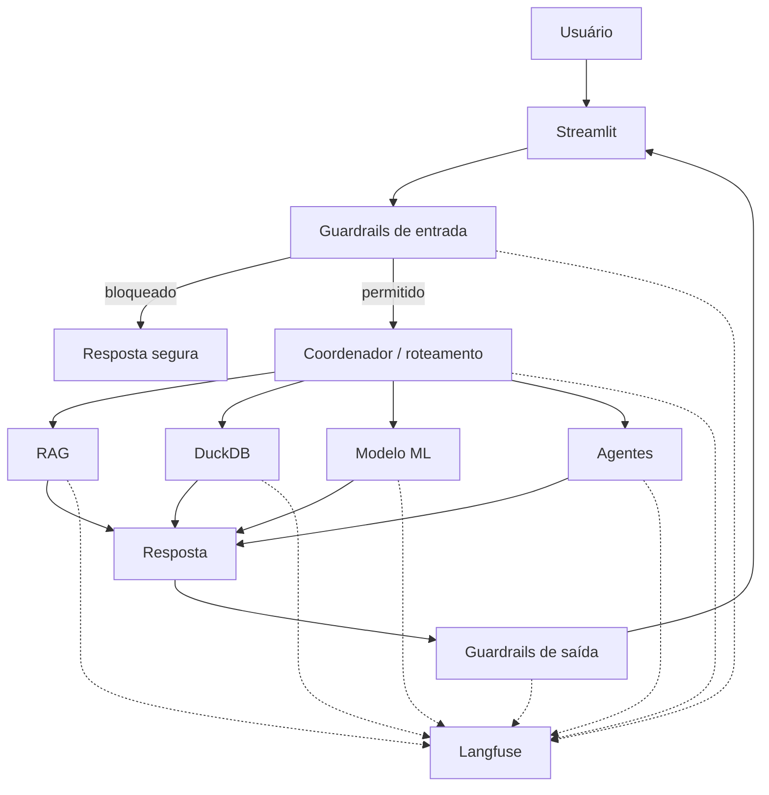

# Assistente ao Expositor — ExpoCatólica 2026

Projeto acadêmico da disciplina **AI Factory: Building Intelligent Systems — PUCPR**.

Protótipo funcional de um assistente inteligente para apoiar expositores e organização da ExpoCatólica 2026. O sistema reúne **RAG**, **DuckDB**, **Machine Learning preditivo**, **agentes especializados**, **observabilidade**, **avaliação automatizada** e **guardrails de segurança** em uma única interface Streamlit.

> **URL pública:** será inserida aqui imediatamente após o deploy no Streamlit Community Cloud.

## Desafio CBL

**Grande ideia:** uso de inteligência artificial para melhorar a operação e o relacionamento com expositores em eventos.

**Pergunta essencial:** como a IA pode facilitar o acesso dos expositores às informações da ExpoCatólica e reduzir a dependência da equipe para resolver dúvidas e acompanhar pendências?

**Desafio:** construir um assistente inteligente capaz de responder dúvidas operacionais, consultar dados estruturados, apoiar análises preventivas e preservar segurança e rastreabilidade.

## Funcionalidades

- Chat em Streamlit com histórico de sessão.
- RAG sobre Manual do Expositor, Regulamento Geral, normas do Pro Magno e FAQ operacional.
- Consultas estruturadas em DuckDB sobre expositores, estandes e pendências.
- Modelo preditivo de classificação treinado com FLAML/LightGBM.
- Dois agentes especializados e um coordenador multiagente.
- Observabilidade com Langfuse.
- Golden Dataset com 15 perguntas e avaliação de Answer Relevancy/Faithfulness.
- Guardrails de entrada e saída.
- Bloqueio de prompt injection, jailbreak e tópicos proibidos.
- Anonimização de PII: e-mail, CPF, CNPJ e telefone.
- Proteção de secrets e conteúdo interno.
- Controle de acesso entre perfis Organização e Expositor.

## Arquitetura



## Stack tecnológica

| Camada | Tecnologia |
|---|---|
| Interface | Streamlit |
| Dados estruturados | DuckDB + CSV |
| RAG | TF-IDF local; arquitetura com fallback para ChromaDB |
| Machine Learning | FLAML + LightGBM |
| Agentes | Orquestração multiagente equivalente |
| Observabilidade | Langfuse |
| Avaliação | Golden Dataset + métricas equivalentes a DeepEval/RAGAS |
| Segurança | Guardrails determinísticos + anonimização de PII |
| CI/Testes | GitHub Actions |
| Deploy | Streamlit Community Cloud |

## Modelo preditivo

Dataset público: **Statlog (German Credit Data)** — UCI Machine Learning Repository, 1.000 registros.

Divisão:
- 700 treino
- 100 validação
- 200 teste

Modelo selecionado: **LightGBM**.

Métricas finais:
- Accuracy: **0,6200**
- Precision: **0,4298**
- Recall: **0,8167**
- F1-score: **0,5632**
- ROC-AUC: **0,7796**

O **recall** foi priorizado porque o objetivo demonstrativo é preventivo: deixar passar um caso de risco sem alerta é considerado mais grave do que gerar alguns alertas adicionais.

> O dataset de crédito é usado apenas por analogia acadêmica e não representa avaliação real de expositores.

## Agentes

### Agente Operacional ExpoCatólica
Consulta documentos e responde sobre regras, prazos, montagem, desmontagem e credenciamento.

### Agente de Dados e Risco
Consulta DuckDB e executa o modelo preditivo.

### Coordenador Multiagente
Combina RAG, dados e ML quando a tarefa exige múltiplas ferramentas.

Exemplo:

```text
Faça uma análise integrada: consulte as pendências da Turismo Peregrino Brasil,
analise o risco do cenário 3 e informe o prazo do projeto técnico.
```

## Segurança — Etapa 3

O fluxo possui proteção antes e depois do processamento.

### Entrada
- prompt injection;
- jailbreak;
- toxicidade;
- tópicos proibidos;
- PII.

### Saída
- secrets;
- PII;
- conteúdo interno.

Três ataques automatizados são demonstrados como bloqueados no workflow de segurança, enquanto uma pergunta legítima continua permitida.

Evidência: [Resultado de Segurança — Etapa 3](docs/RESULTADO_SEGURANCA_ETAPA3.md).

## Observabilidade

O Langfuse registra traces e spans para:
- chat;
- recuperação RAG;
- consultas DuckDB;
- modelo preditivo;
- agentes;
- guardrails.

Documentação: [Observabilidade Langfuse](docs/OBSERVABILIDADE_LANGFUSE.md).

## Avaliação

Golden Dataset com **15 perguntas**:
- fáceis;
- intermediárias;
- difíceis;
- ambíguas;
- fora do escopo.

Resultado final da Etapa 2:
- 12/15 aprovadas;
- taxa de aprovação: **80%**;
- Answer Relevancy média: **0,9778**;
- Faithfulness média: **0,7096**.

Resultados: [RESULTADO_AVALIACAO.md](avaliacao/resultados/RESULTADO_AVALIACAO.md).

## Como rodar localmente

Recomendado: **Python 3.12**.

```bash
python -m venv .venv
```

Windows:

```bash
.venv\Scripts\activate
pip install -r requirements.txt
streamlit run app.py
```

Linux/macOS:

```bash
source .venv/bin/activate
pip install -r requirements.txt
streamlit run app.py
```

O aplicativo funciona em modo local sem chave de LLM.

## Variáveis de ambiente

Copie `.env.example` para `.env` apenas no ambiente local.

```env
OPENAI_API_KEY=...
OPENAI_MODEL=gpt-4.1-mini
LANGFUSE_PUBLIC_KEY=...
LANGFUSE_SECRET_KEY=...
LANGFUSE_BASE_URL=https://cloud.langfuse.com
```

**Nunca** publique o arquivo `.env` ou `.streamlit/secrets.toml`.

No Streamlit Community Cloud, os secrets são configurados na área de **Advanced settings / Secrets** e não ficam armazenados no GitHub.

## Estrutura principal

- `app.py` — interface Streamlit.
- `assistant_engine.py` — roteamento e fluxo central.
- `security.py` — guardrails de entrada/saída e anonimização.
- `database.py` — DuckDB.
- `rag_engine.py` — recuperação documental.
- `ml_engine.py` — inferência do modelo preditivo.
- `agents.py` — agentes e coordenador.
- `observability.py` — Langfuse.
- `dados/` — dados fictícios de demonstração.
- `documentos/` — base RAG.
- `avaliacao/` — Golden Dataset e resultados.
- `testes/` — testes automatizados.
- `.github/workflows/` — CI de agentes, segurança, avaliação e deploy.
- `docs/` — documentação técnica e evidências.

## Testes automatizados

GitHub Actions valida:
- integridade;
- agentes;
- Golden Dataset;
- segurança;
- ambiente de deploy.

## Limitações conhecidas

1. Os dados tabulares de expositores são fictícios.
2. O modelo de risco usa uma base pública de crédito por analogia acadêmica.
3. O RAG em deploy prioriza uma alternativa leve baseada em TF-IDF para reduzir dependências e consumo de memória.
4. Os guardrails determinísticos não substituem classificadores semânticos especializados em um ambiente de produção.
5. O modo LLM depende de uma chave externa; sem ela, o sistema continua operando no modo local.
6. O protótipo não substitui documentos oficiais ou orientação da Promocat/CAEX.

## Privacidade e segurança

- Nenhum secret é versionado.
- `.env` e `.streamlit/secrets.toml` são ignorados pelo Git.
- Consultas SQL usam rotas controladas/parametrizadas.
- Perfil Expositor não acessa dados estruturados de outro expositor.
- PII é anonimizada antes de seguir pelo fluxo.
- Secrets encontrados na saída são mascarados.

## Evidências

- [Resultado do treinamento ML](ml/model/RESULTADO_TREINAMENTO.md)
- [Agentes da Etapa 2](docs/AGENTES_ETAPA2.md)
- [Observabilidade](docs/OBSERVABILIDADE_LANGFUSE.md)
- [Golden Dataset](avaliacao/golden_dataset.json)
- [Resultado da avaliação](avaliacao/resultados/RESULTADO_AVALIACAO.md)
- [Segurança da Etapa 3](docs/RESULTADO_SEGURANCA_ETAPA3.md)

## Uso acadêmico

Projeto desenvolvido para a disciplina **AI Factory: Building Intelligent Systems**, PUCPR. Os dados demonstrativos não devem ser interpretados como dados reais de expositores nem como decisões automatizadas reais.
